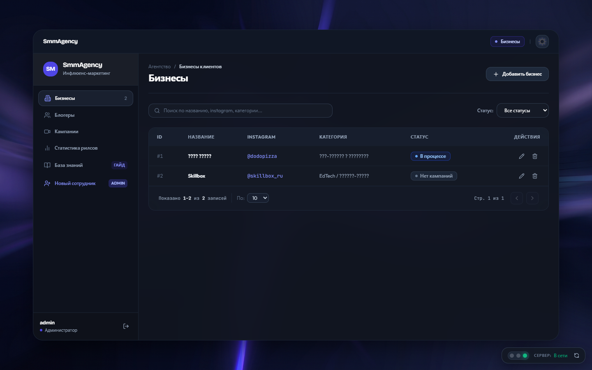
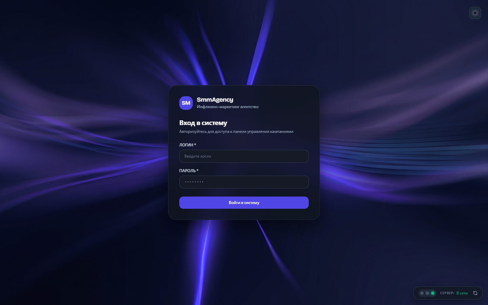
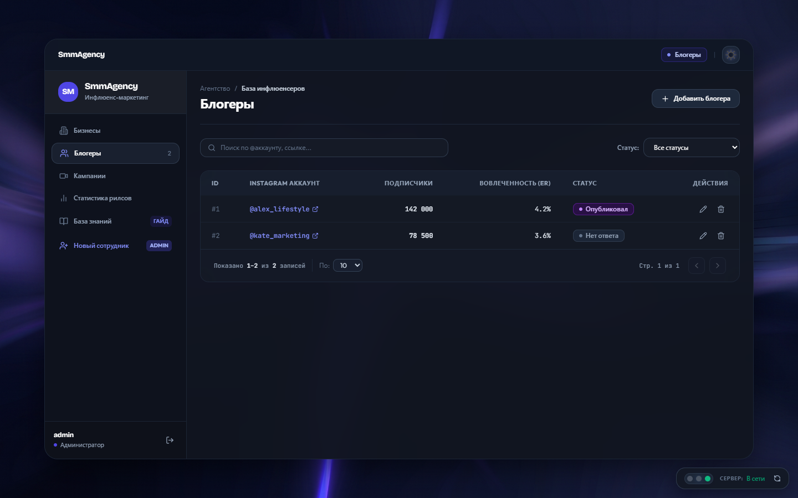
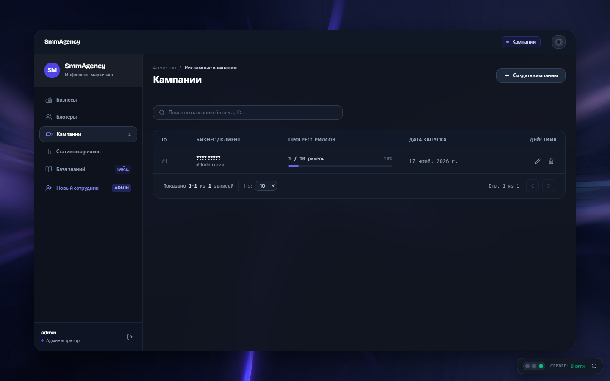
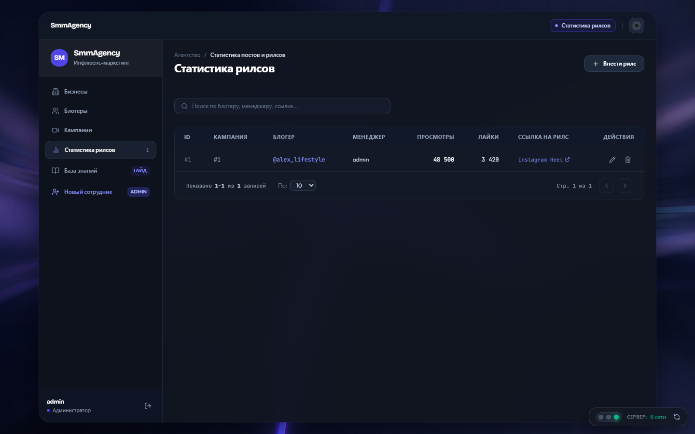
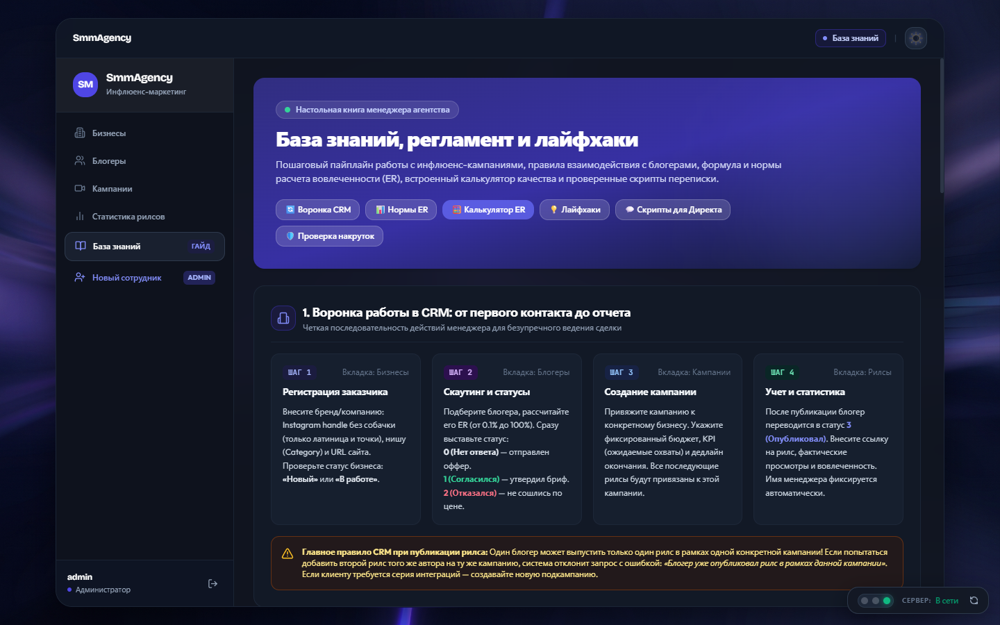
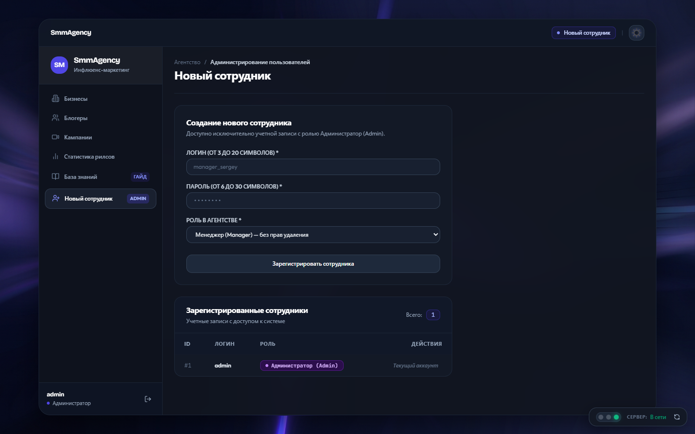
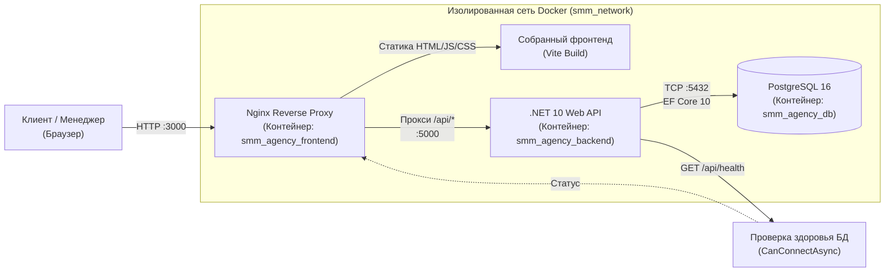
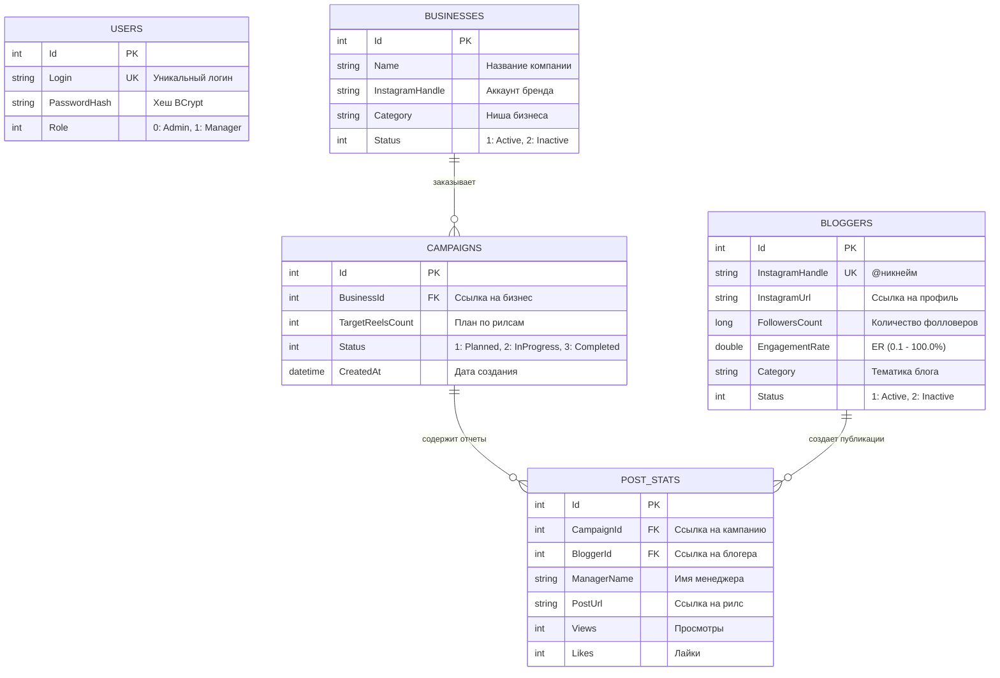
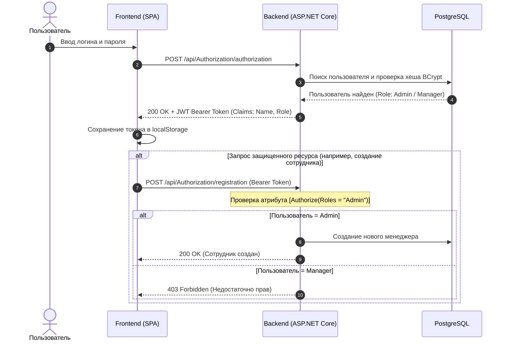

# SmmAgency — Платформа управления инфлюенс-маркетингом и SMM-кампаниями

<p align="center">
  
</p>

<p align="center">
  
  
  
  
  
  
  
  
</p>

---

## О проекте

Большинство SMM-агентств и маркетинговых команд ведут учет инфлюенсеров в разрозненных Google Таблицах. В результате:
* Теряются договоренности: сложно отследить, с кем из блогеров уже вышли интеграции, а кто сорвал дедлайн.
* Менеджеры вручную высчитывают коэффициент вовлеченности (ER) и просмотры на калькуляторе.
* Руководство агентства не видит прозрачной сводки: сколько рилсов согласовано, сколько опубликовано и окупается ли бюджет клиента.

**SmmAgency** — это специализированная B2B CRM-система, спроектированная под процессы инфлюенс-маркетинга. Она объединяет ведение базы клиентов и блогеров, запуск рекламных кампаний, учет рилсов и расчет аналитики эффективности.

---

## Интерфейс и скриншоты

Интерфейс построен по кастомной дизайн-системе Liquid Glass (матовые стеклянные панели, адаптивная верстка и минималистичная типографика).

| Экран | Описание |
| :--- | :--- |
| **01. Окно авторизации**<br/>`docs/screenshots/01-login.png` | Вход по JWT-токенам. В правом нижнем углу расположен виджет состояния базы данных: 🔴 Офлайн, 🔵 Опрос, 🟢 В сети. |
| **02. Бизнесы клиентов**<br/>`docs/screenshots/02-businesses.png` | Реестр брендов-заказчиков с поиском в реальном времени, фильтрами статусов, пагинацией и модальными окнами добавления/редактирования. |
| **03. База инфлюенсеров**<br/>`docs/screenshots/03-bloggers.png` | Каталог блогеров с прямыми ссылками на профили, категориями, числом подписчиков и предрассчитанным ER (*Engagement Rate*). |
| **04. Рекламные кампании**<br/>`docs/screenshots/04-campaigns.png` | Связка клиента и блогеров. Система автоматически считает процент выполнения плана по рилсам и переключает статусы (`Запланирована` -> `В процессе` -> `Завершена`). |
| **05. Аналитика рилсов**<br/>`docs/screenshots/05-post-stats.png` | Учет публикаций: просмотры, лайки, ответственный менеджер, прямая ссылка на видео и динамический статус успешности. |
| **06. Интерактивная база знаний**<br/>`docs/screenshots/06-guide.png` | Регламент работы агентства и встроенный калькулятор ER для быстрой оценки качества блогера перед покупкой рекламы. |
| **07. Управление сотрудниками (RBAC)**<br/>`docs/screenshots/07-register.png` | Доступно только Администратору. Создание учетных записей для менеджеров и разграничение прав доступа. |

<details>
<summary><b>Развернуть полноразмерные скриншоты</b></summary>

### 1. Авторизация и виджет статуса сервера


### 2. Реестр бизнесов клиентов


### 3. Каталог блогеров


### 4. Управление кампаниями


### 5. Статистика рилсов


### 6. База знаний и ER-калькулятор


### 7. Создание сотрудников (Панель Администратора)


</details>

---

## Архитектура системы

### 1. Общая топология сервисов (Infrastructure Overview)

Система полностью контейнеризирована через Docker Compose. Все входящие веб-запросы принимает сервер Nginx, который раздает статику фронтенда и прозрачно проксирует API-запросы к бэкенду.



---

### 2. Схема базы данных (Entity-Relationship Diagram)



---

### 3. Ролевая модель и безопасность (RBAC Sequence Diagram)



---

## Быстрый старт

### Способ 1. Запуск через Docker Compose (Рекомендуемый)

Для запуска всего стека (База данных + Бэкенд + Фронтенд) требуется только установленный **Docker Desktop**.

1. **Клонируйте репозиторий:**
   ```bash
   git clone https://github.com/westbee-dev/SmmAgency.git
   cd SmmAgency
   ```

2. *(Опционально)* Настройте переменные окружения:
   ```bash
   # Linux / macOS:
   cp .env.example .env

   # Windows (PowerShell):
   Copy-Item .env.example .env
   ```

3. **Запустите проект одной командой:**
   ```bash
   docker compose up --build -d
   ```

4. **Откройте приложение в браузере:**
   * **Веб-интерфейс CRM:** [http://localhost:3000](http://localhost:3000)
   * **Swagger API Docs:** [http://localhost:5000/swagger](http://localhost:5000/swagger)

5. **Данные для первого входа в систему:**
   * **Логин:** `admin`
   * **Пароль:** `Admin123!` *(пароль можно изменить в `.env`)*

---

### Способ 2. Локальный запуск для разработки (без Docker)

#### Требования:
* [.NET 10 SDK](https://dotnet.microsoft.com/)
* [Node.js 20+](https://nodejs.org/)
* Локальный сервер [PostgreSQL 15+](https://www.postgresql.org/)

#### 1. Запуск Бэкенда:
```bash
cd Backend/SmmAgency.Api

# Укажите строку подключения в appsettings.Development.json или через User Secrets:
dotnet user-secrets set "ConnectionStrings:DefaultConnection" "Host=localhost;Port=5432;Database=smm_agency;Username=postgres;Password=ВАШ_ПАРОЛЬ"

# Запуск API (миграции базы данных применятся автоматически при старте):
dotnet run
```
API станет доступно на `http://localhost:5000`.

#### 2. Запуск Фронтенда:
```bash
cd Frontend

# Установка зависимостей:
npm install

# Запуск dev-сервера с горячей перезагрузкой:
npm run dev
```
Фронтенд откроется на `http://localhost:5173`.

---

## Стек технологий

### Backend:
* **Платформа:** .NET 10.0 (C# 13)
* **Архитектура:** Чистая слоистая структура (`Api` -> `Core` -> `Data`)
* **ORM:** Entity Framework Core 10 (Npgsql PostgreSQL Provider)
* **Аутентификация:** JWT Bearer Tokens + BCrypt.Net для безопасного хеширования паролей
* **Валидация:** FluentValidation с автоматической валидацией моделей
* **Безопасность:**
  * Rate Limiting (ограничение попыток подбора паролей: 5 запросов/мин на IP)
  * Защита от перегрузки (Request Timeouts на 15 секунд)
  * Kestrel MaxRequestBodySize (ограничение тела запроса до 2 МБ)
  * CORS-политики для строгого списка доверенных источников
* **Документация:** Swagger / OpenAPI с интеграцией Bearer Auth

### Frontend:
* **Сборщик:** Vite 6
* **Стилизация:** Tailwind CSS v4 + кастомная дизайн-система Liquid Glass
* **Архитектура JS:** Модульный чистый JavaScript (ES Modules, единый API-клиент `client.js`, `authGuard.js`)
* **UX/UI:** Тост-уведомления, модальные диалоги подтверждения удаления, монитор здоровья БД в реальном времени

### DevOps и инфраструктура:
* **Docker & Docker Compose:** Мультистейдж-сборки (Multi-stage builds) для минимального размера образов
* **Nginx Alpine:** Раздача статики с Gzip-сжатием (уровень 6), агрессивным кэшированием ассетов и проксированием API

---

## Безопасность и управление секретами

В проекте соблюдаются базовые стандарты безопасности:
1. **Отсутствие секретов в Git:** Файл `.gitignore` блокирует `.env`, `.env.*`, а также конфигурационные файлы среды `**/appsettings.*.json`.
2. **Шаблоны конфигураций:** В репозиторий включены безопасные публичные шаблоны `.env.example` и `appsettings.json` с плейсхолдерами.
3. **Безопасность первого входа:** После развертывания проекта Администратор задает пароль через переменную окружения `DEFAULT_ADMIN_PASSWORD` и создает персональные учетные записи сотрудникам через форму в CRM.

---

## Структура репозитория

```text
SmmAgency/
├── docs/
│   └── screenshots/               # Скриншоты интерфейса для README
│       ├── 01-login.png
│       ├── 02-businesses.png
│       ├── 03-bloggers.png
│       ├── 04-campaigns.png
│       ├── 05-post-stats.png
│       ├── 06-guide.png
│       └── 07-register.png
├── Backend/                       # Бэкенд-решение .NET 10
│   ├── Dockerfile                 # Multi-stage сборка .NET Web API
│   ├── SmmAgency.Api/             # Контроллеры, DTO, Валидаторы, Middlewares
│   ├── SmmAgency.Core/            # Доменные сущности (Business, Blogger, Campaign, PostStat, User)
│   ├── SmmAgency.Data/            # DbContext и миграции Entity Framework Core
│   └── SmmAgency.slnx             # Файл решения .NET
├── Frontend/                      # Фронтенд-приложение (Vite + Tailwind v4)
│   ├── Dockerfile                 # Сборка Vite и деплой в Nginx Alpine
│   ├── nginx.conf                 # Конфигурация Nginx (gzip, routing, proxy)
│   ├── src/
│   │   ├── css/styles.css         # Стили и дизайн-система Liquid Glass
│   │   └── js/
│   │       ├── api/               # HTTP-клиенты и типизированные запросы
│   │       ├── auth/              # AuthGuard и ролевая фильтрация
│   │       ├── pages/             # Контроллеры страниц CRM
│   │       └── utils/             # Виджет светофора БД, модалки, тосты, JWT
│   ├── businesses.html            # Страница бизнесов
│   ├── bloggers.html              # Страница блогеров
│   ├── campaigns.html             # Страница кампаний
│   ├── post-stats.html            # Страница аналитики рилсов
│   ├── guide.html                 # База знаний и ER-калькулятор
│   ├── register.html              # Админ-панель создания сотрудников
│   └── index.html                 # Окно авторизации
├── .dockerignore
├── .env.example                   # Шаблон переменных окружения
├── .gitignore                     # Правила исключений Git
├── docker-compose.yml             # Оркестрация контейнеров (db, backend, frontend)
├── DOCKER_GUIDE.md                # Обучающий конспект по Docker для Obsidian
└── README.md                      # Главная документация проекта
```

---

## Основные эндпоинты API

| Метод | Эндпоинт | Роль | Описание |
| :--- | :--- | :--- | :--- |
| `GET` | `/api/health` | Анонимный | Проверка здоровья API и соединения с PostgreSQL |
| `POST` | `/api/Authorization/authorization` | Анонимный | Вход в систему и получение JWT Bearer токена |
| `POST` | `/api/Authorization/registration` | **Admin** | Регистрация нового менеджера/администратора |
| `GET` | `/api/Businesses` | Авторизован | Получение списка бизнесов с пагинацией и поиском |
| `POST` | `/api/Businesses` | Авторизован | Создание нового бизнеса клиента |
| `GET` | `/api/Bloggers` | Авторизован | Каталог блогеров с фильтрацией по статусу и ER |
| `POST` | `/api/Bloggers` | Авторизован | Добавление инфлюенсера в базу |
| `GET` | `/api/Campaigns` | Авторизован | Реестр кампаний с динамическим расчетом прогресса |
| `POST` | `/api/Campaigns` | Авторизован | Создание рекламной кампании |
| `GET` | `/api/PostStats` | Авторизован | Сводная аналитика и статистика по рилсам |
| `POST` | `/api/PostStats` | Авторизован | Добавление отчета о вышедшем рилсе |

Полная интерактивная спецификация с возможностью отправки тестовых запросов доступна в Swagger по адресу: `http://localhost:5000/swagger`.

---

## Лицензия

Проект распространяется под лицензией **MIT**.
